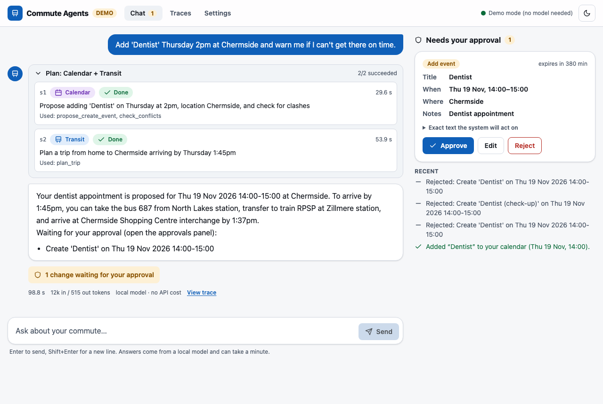

# Commute Agents

A multi-agent personal assistant for commute questions (transit, weather, calendar), built to
show orchestration, tool use, evaluation, tracing, safety and cost awareness. Single user,
South East Queensland. **Free and local:** the LLM runs on your machine via Ollama, and only
public, freely provided data sources are used. No paid API keys.

**Status: Phase 6 of 9 done (web UI).** Backend plus a React UI: chat with a live plan, approval cards,
trace viewer and settings. Evaluation (Phase 7) and data science (Phase 8) are next.



## What exists
- `backend/app/core/`: Ollama client wrapper, generic tool-using agent loop with step/token/time
  limits, tool registry with code-enforced permissions, SQLite tracing with secret redaction.
- `backend/app/agents/transit/`: TransLink GTFS ingest + realtime merge + own journey planner,
  5 read-only tools, CLI that needs no LLM.
- `backend/app/agents/weather/`: Open-Meteo client and a deterministic `commute_advice` (rain / heat / UV /
  wind / transit delays -> leave now or wait, what to bring, confidence). Thresholds documented in
  `docs/decisions.md`.
- `backend/app/agents/calendar/` + `core/approvals.py`: free-slot finder, local calendar + read-only `.ics`
  import, and an approval gate: the agent can only *propose*; a human approves the exact payload before
  anything changes. See `docs/safety.md` (permissions table, threat model, injection tests).
- `backend/app/orchestrator/` + `main.py`: router -> dependency-aware, concurrent specialist steps -> synthesiser,
  streamed over SSE, with approvals, traces and health endpoints. See `docs/architecture.md`.
- `frontend/`: React 19 + TypeScript (strict) + Tailwind. Chat with the plan as live status chips, approval cards
  that show exactly what will change, a trace waterfall, settings, light/dark, keyboard and phone friendly.
  Pure logic (SSE parsing, chat reducer, markdown, waterfall maths, contrast) is unit tested; the whole flow is
  covered by Playwright against **demo mode**.
- `backend/app/demo/`: demo mode, see below.
- 538 backend tests (98% coverage on core, agents, orchestrator and API), 74 frontend unit tests, 13 browser tests.

## Journey planner (the UI's home page)
A TransLink-style planner with no LLM involved: From/To search (saved places, stops, and addresses via OpenStreetMap),
day + time with *Leave after* / *Arrive before*, several travel options with live delays, an expandable step-by-step
timeline, and a real zoomable map (OpenStreetMap or satellite, down to street level). Also: departures board, service
alerts for the selected trip, up to three added stops (with a stay time at each), live buses, trains, trams and ferries on the map (GTFS-Realtime VehiclePositions; click a departure or a vehicle to see where it is and the road route it takes), sort/filter (changes, walking, mode), earlier/later services, shareable URL, print.
Laid out for a 14" laptop: icon rail + a 29%-wide panel + a full-height map, no page scroll. The chat assistant moved to
`#/assistant`; Agents, Analytics, Evaluation and Traces now live together under **Insights**. On a phone the rail becomes a bottom tab bar. Endpoints: `GET /places`, `/plan`, `/departures`, `/alerts`, `/vehicles` (`backend/app/planner_api.py`).
Privacy: the basemap is a sharp vector map from OpenFreeMap (no key; styles Detailed, Clean and Dark), with Esri satellite and raster tiles as options, all fetched by your browser, and address search (`geocode=1`) sends the typed
text to OpenStreetMap Nominatim only when the timetable has too few stop matches. There is no fare estimate: the GTFS
feed has no fare data.

## Quick start
```bash
make setup
make test && make lint
cd backend && uv run python -m scripts.hello_agent --offline   # scripted, no LLM needed

# live, with a local model:
brew install ollama && ollama serve        # or open the Ollama app
ollama pull qwen3:8b
cd backend && uv run python -m scripts.hello_agent
```

## Try the transit agent (no LLM needed)
```bash
cd backend
uv run python -m app.agents.transit.cli refresh                       # one-off 43 MB download
uv run python -m app.agents.transit.cli departures home --limit 5
uv run python -m app.agents.transit.cli plan home chermside --arrive "tomorrow 9am"
uv run python -m app.agents.transit.cli alerts --route 680
uv run python -m scripts.transit_agent "Next 3 buses from home tomorrow at 7:30?"   # with Ollama
```
`home` is configurable in `backend/data/profile.json` (default: North Lakes station).

## Try the weather agent
```bash
cd backend
uv run python -m app.agents.weather.cli forecast --hours 8      # no LLM, live Open-Meteo
uv run python -m scripts.commute_advice --no-llm --origin home --dest chermside --depart "tomorrow 8am"
uv run python -m scripts.commute_advice "Should I leave now or wait? It looks like rain." --depart "tomorrow 8am"
```

## Try the UI (no model needed): demo mode
```bash
make setup
make demo      # backend on :8000 replaying recorded answers; a fake calendar; nothing real is touched
make ui        # http://localhost:5173
```
Demo mode replays seven answers that were **recorded once from the real pipeline and local model** with frozen data
(clock Wed 18 Nov 2026 07:45, a frozen forecast with one *synthetic* rain shower so "leave now or wait?" has something
to show, frozen realtime feed). Approval cards are re-created in the real approval gate, so Approve, Edit and Reject
really run against the fake calendar. It only knows those questions and says so for anything else; it is a demo, not
the assistant. Re-record with `uv run python -m scripts.record_demo` (needs Ollama).

## Run the whole assistant
```bash
make dev                                   # API on http://localhost:8000 (needs Ollama running)
curl -N -X POST localhost:8000/chat -H 'content-type: application/json' \
  -d '{"session_id":"me","message":"Next 3 buses from home to Chermside tomorrow at 8"}'   # SSE stream
curl localhost:8000/approvals?status=pending       # cards waiting for you
curl localhost:8000/health                         # models, feeds, last GTFS check
uv run python -m scripts.ask "Find me a free 30 minute slot tomorrow afternoon and how to get to Chermside for it."
```
For the real thing with the UI: `make dev` (needs Ollama) in one terminal, `make ui` in another.
`scripts.ask` uses a throwaway demo calendar and database. Expect 35-115 s per answer on a laptop: the local 8B
model is the bottleneck (see `docs/decisions.md`, "Latency, honestly").

## Try the calendar agent (throwaway demo calendar; your data is never touched)
```bash
cd backend
uv run python -m scripts.calendar_agent "Find me a free 1 hour slot tomorrow afternoon."
uv run python -m scripts.calendar_agent "Add 'Dentist' on Thursday at 2pm" --approve   # --approve plays the human
uv run python -m scripts.calendar_agent "What's on my calendar tomorrow?"              # includes a hostile event
```
Put a `.ics` export in `backend/data/calendar/import/` to read it (read-only). Google Calendar is not supported.

## Verified against real services vs fixtures
Run live: TransLink GTFS + GTFS-Realtime (ingest, realtime merge, planner, alerts, daily refresh), Open-Meteo, the
three agents, the orchestrator and the real HTTP server (SSE chat, approvals, traces) against a local Ollama server (`qwen3:8b`). The calendar agent has been run live against a demo calendar (local LLM only); no real calendar export and no
Google Calendar (not built) have been tested. Unit tests use
a hand-made feed and scripted clients. See `docs/decisions.md`.
