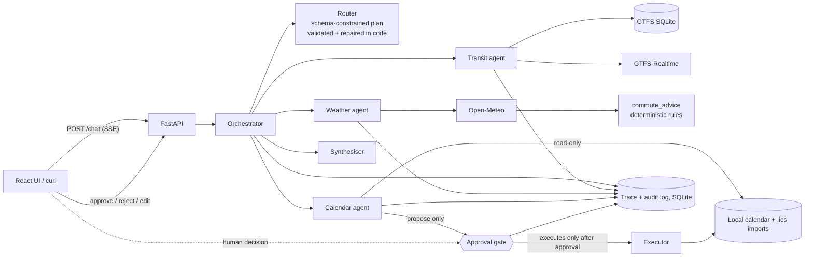

# Architecture

One user, one machine. The LLM is a local Ollama model; the only network calls are to public feeds
(TransLink GTFS/GTFS-Realtime, Open-Meteo). Nothing leaves the machine except those feed requests.

## One request

1. **Route.** The router returns a JSON plan (`steps`, `depends_on`). Code validates it, derives the intent, repairs
   what is safely repairable, refuses plans that assume a destination the user never named, and retries once.
2. **Execute.** Steps run as soon as their own dependencies finish; independent steps run concurrently. Earlier
   results reach later steps as **structured tool output**; times like `{s1.start-15m}` are filled in by code.
   Agents never call each other.
3. **Propose.** The calendar agent can only create a pending card. Cards stream to the UI as `approval_required`.
4. **Synthesise.** One model call writes the reply from the structured results. Code owns the facts that must be
   true: failures are always mentioned, and approval status is appended from the real queue.
5. **Trace.** Every model call and tool call is a span (tokens, latency, prompt version). `GET /traces/{id}` returns the tree.

## Where the logic lives (and why)

| Concern | Lives in | Because |
|---|---|---|
| Journey planning, delays, cancellations | `agents/transit` (RAPTOR-style planner, realtime merge) | correctness is checkable; an 8B model is not a planner |
| Leave now / wait, what to bring | `agents/weather/advice.py` (rules) | thresholds are documented and unit tested |
| Free slots, conflicts | `agents/calendar/slots.py` (pure function) | easy to test exhaustively |
| Dates and time arithmetic | `core/timeutil.py`, `orchestrator/placeholders.py` | the model got these wrong every time it was allowed to |
| What may change the world | `core/approvals.py` + `agents/calendar/executor.py` | prompts are not a security boundary |

Safety design: `docs/safety.md`. Decisions, corrections to the brief and live findings: `docs/decisions.md`.
